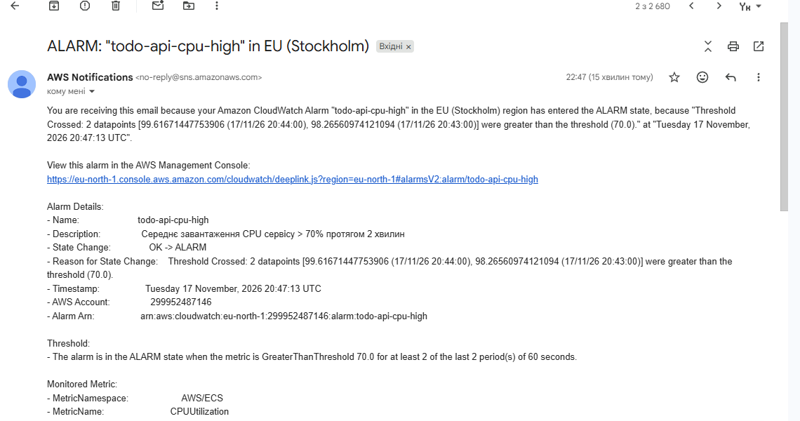
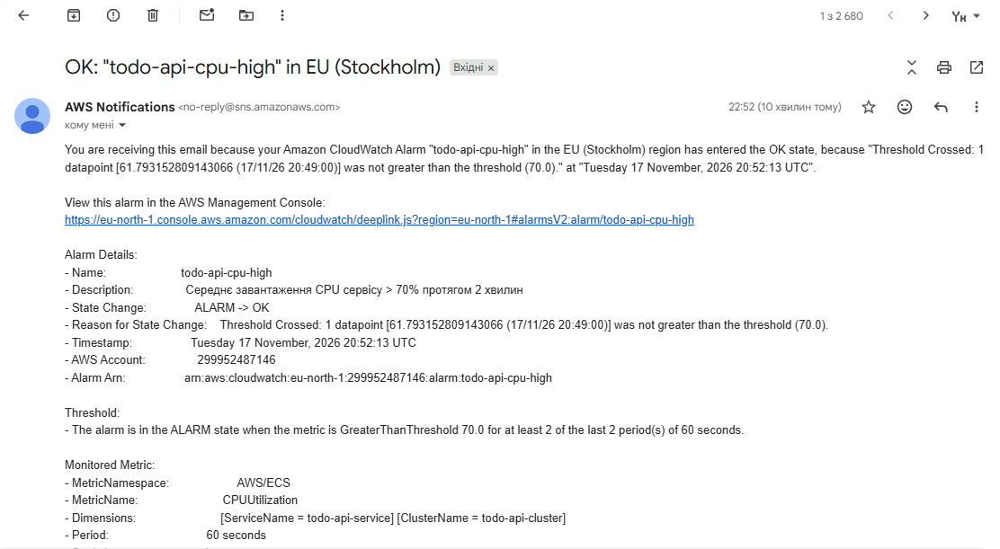
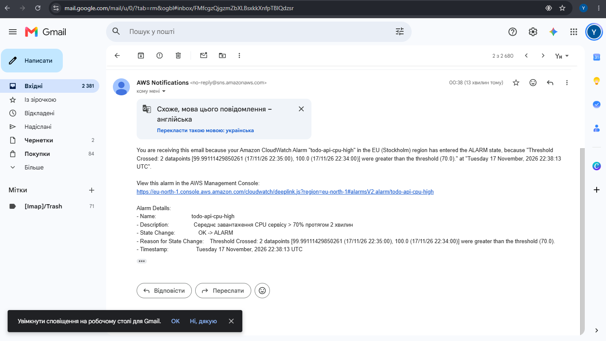
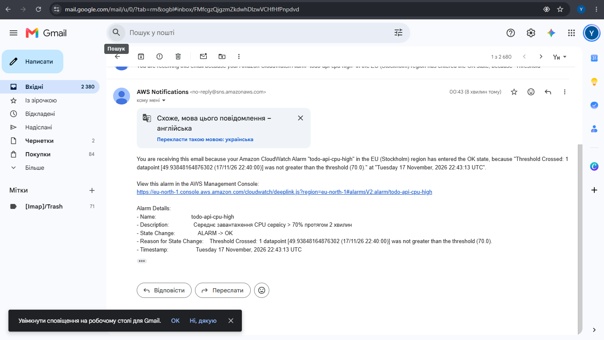

# Сповіщення

Файл Terraform: [`monitoring.tf`](../monitoring.tf) — `aws_cloudwatch_metric_alarm.cpu_high`, `aws_sns_topic.alerts`, `aws_sns_topic_subscription.email`.

## Умова

Середнє `CPUUtilization` сервісу (`AWS/ECS`) > 70 % протягом 2 хвилин (`period = 60`, `evaluation_periods = 2`).

**Обґрунтування.** Поріг 70 % вищий за ціль масштабування (60 %): сповіщення має означати, що автомасштабування не справляється або ще не встигло, а не просто що воно працює. Вимога «2 хвилини» відсікає короткі піки (захист від flapping). Лист про норму надсилається через `ok_actions` у той самий SNS-топік.

Адреса отримувача задається змінною `alert_email` у `terraform.tfvars` (не в репозиторії). Після `apply` на пошту приходить лист підтвердження підписки SNS — без натискання посилання листи не доставляються.

## Знімки листів

Прогін 17.11.2026 (старт k6 о 22:41:08 за місцевим часом = 20:41:08 UTC, стале навантаження з 20:44:08 UTC). У листі ALARM: 2 точки (20:43 — 98,27 %, 20:44 — 99,62 %) перевищили поріг 70 %. Лист OK прийшов, коли CPU впав до 61,79 % (точка 20:49) — після появи другого екземпляра.

Прогін 17.11.2026, без кешу (старт k6 о 22:32:07 UTC, плато з ≈22:35:07 UTC): ALARM о 22:38:13 UTC (2 точки: 22:34 — 100 %, 22:35 — 99,99 %), OK о 22:43:13 UTC (точка 22:40 — 49,9 %). 

(Листи першого прогону, 16.11: ALARM о 20:39:13 UTC і OK о 20:44:13 UTC — [alarm](img/mail-alarm.png), [ok](img/mail-ok.png).)

## Час реакції

| Подія | Час (UTC) |
|---|---|
| Початок сталого навантаження | 20:44:08 |
| Перша точка CPU понад 70 % | 20:43 |
| Перший лист (ALARM, зміна стану OK → ALARM) | 20:47:13 |
| Лист про норму (OK) | 20:52:13 |

Від початку сталого навантаження до першого листа минуло близько 3 хв 5 с (від старту тесту — близько 6 хв 5 с).

Складові затримки: публікація метрики CloudWatch для ECS (метрика за хвилину з'являється із запізненням 1–2 хв) → 2 періоди оцінки по 60 с → зміна стану й доставка SNS → пошта (секунди). Друга порушена точка мала мітку 20:44, а лист прийшов о 20:47:13, тобто основна затримка — це затримка самої метрики.

**Оцінка.** Для навчального сервісу прийнятно. Для реального сервісу з SLA кілька хвилин слід скоротити: за вищою роздільною здатністю метрик (10 с), сповіщенням за латентністю/частотою помилок (те, що відчуває користувач) і доставкою не лише поштою, а й у месенджер/пейджер.
