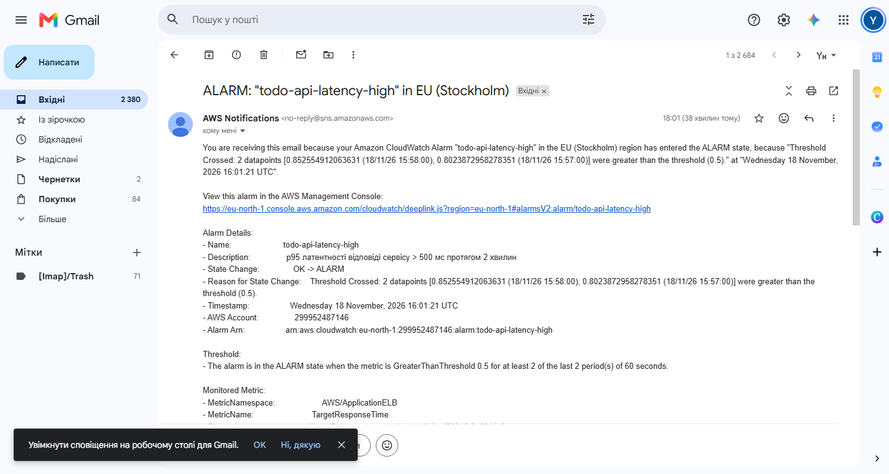
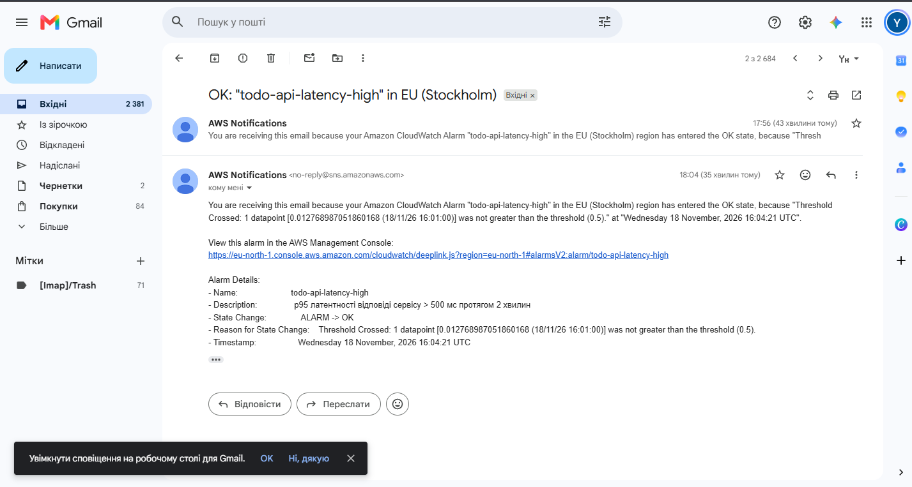

# Сповіщення

Файл Terraform: [`monitoring.tf`](../monitoring.tf) — `aws_cloudwatch_metric_alarm.latency_high`, `aws_sns_topic.alerts`, `aws_sns_topic_subscription.email`.

## Умова

p95 латентності відповіді сервісу (`TargetResponseTime` ALB, статистика p95) **> 500 мс протягом 2 хвилин** (`period = 60`, `evaluation_periods = 2`). Лист про норму надсилається через `ok_actions` у той самий SNS-топік.

**Обґрунтування.**
- p95 латентності — це те, що відчуває користувач: 5 % запитів повільніші за 500 мс. Для API 500 мс — межа, після якої сервіс уже здається повільним. CPU — показник ресурсу, а не якості обслуговування, і не завжди відображає проблему користувача (питання 14 з переліку).
- Вимога «2 хвилини» відсікає короткі піки (захист від flapping — частого перемикання між станами норма/тривога) і одиничні повільні запити.
- Сповіщення за CPU (> 70 % протягом 2 хвилин) працювало в перших прогонах (див. додаток), але після швидшого масштабування CPU може не триматися понад 70 % дві хвилини поспіль, і лист би не прийшов. Латентність проблему показує завжди, поки не додано ресурсів.

Адреса отримувача задається змінною `alert_email` у `terraform.tfvars` (не в репозиторії). Після `apply` на пошту приходить лист підтвердження підписки SNS — без натискання посилання листи не доставляються.

## Листи за прогон 18.11.2026 (старт k6 о 15:55:15 UTC)

Тест триває 10 хвилин: плато 15:58:15–16:03:15, кінець 16:05:15. Усі часи — UTC.

**Лист ALARM — 16:01:21 UTC.** Точки p95 15:57 (0,80 с) і 15:58 (0,85 с) перевищили поріг 0,5 с.

**Лист OK — 16:04:21 UTC.** Точка p95 16:01 (0,013 с) нижче порога.

**Перший лист OK о 15:56:21 — це не сповіщення про відновлення.** Сигнал щойно створено, він був у стані «немає даних» (`INSUFFICIENT_DATA`), а з появою першої точки (p95 = 0,002 с у хвилину 15:53, нижче порога) перейшов в OK, і через `ok_actions` пішов лист. Реальна пара листів — ALARM 16:01:21 і OK 16:04:21. Обидва прийшли **до кінця тесту** (16:05:15). Для наочності: [список вхідних](img/mail-list-final.png).

## Час реакції

| Подія | Час (UTC) |
|---|---|
| Початок плато | 15:58:15 |
| p95 понад 500 мс (перша точка) | 15:57 (0,80 с) |
| Лист ALARM | 16:01:21 |
| Від початку плато до листа ALARM | **3 хв 6 с** |
| Лист OK | 16:04:21 |
| Кінець тесту | 16:05:15 |

Складові затримки: ALB публікує хвилинну метрику латентності із запізненням 1–2 хв → 2 періоди оцінки по 60 с → зміна стану й доставка SNS → пошта (секунди). Друга порушена точка (15:58) закінчилась о 15:59:00, лист прийшов о 16:01:21: ≈2 хв 20 с затримки.

**Лист ALARM прийшов, коли масштабування вже все виправило.** Нові екземпляри з'явились о 15:59:40, і p95 упала до 0,013 с у хвилину 16:01, тобто в момент листа проблема практично зникла (див. [AUTOSCALING.md](AUTOSCALING.md)). Лист відображає дані за 15:57–15:58 через затримку метрики.

**Оцінка.** Для навчального сервісу 3 хвилини прийнятні. Для реального сервісу з SLA це забагато: користувачі відчували повільні відповіді вже з 15:57, а сповіщення прийшло лише о 16:01. Час слід скоротити: вищою роздільною здатністю метрик (10 с), одним періодом оцінки для критичних порогів, а також доставкою не лише поштою, а й у месенджер або пейджер.

## Додаток: перші прогони зі сповіщенням за CPU (> 70 % протягом 2 хвилин)

Спочатку сповіщення стежило за `CPUUtilization` сервісу (`AWS/ECS`). Збережено як результат перших ітерацій (17.11.2026, час UTC):

| Прогін | Початок плато | Лист ALARM | Від початку плато | Кінець тесту | Лист OK |
|---|---|---|---|---|---|
| A (старт 20:41:08) | 20:44:08 | 20:47:13 | 3 хв 5 с | 20:51:08 | 20:52:13 |
| B (старт 21:37:05) | 21:40:05 | 21:45:13 | 5 хв 8 с | 21:47:05 | 21:50:13 |
| C (старт 22:32:07) | 22:35:07 | 22:38:13 | 3 хв 6 с | 22:42:07 | 22:43:13 |

У цих прогонах лист OK приходив уже після завершення тесту, бо CPU падав нижче 70 % лише тоді, коли нові екземпляри з'являлись пізно (див. [AUTOSCALING.md](AUTOSCALING.md)); лист запізнювався ще на ≈3 хв за точкою, яка знизила CPU. Листи кожного прогону:

- A: [ALARM](img/mail-alarm-17.png), [OK](img/mail-ok-17.png)
- B: [ALARM](img/mail-alarm-cache.png), [OK](img/mail-ok-cache.png)
- C: [ALARM](img/mail-alarm-nocache.png), [OK](img/mail-ok-nocache.png)
- Перший прогін 16.11 (старт 20:32:49): ALARM 20:39:13 — [alarm](img/mail-alarm.png), OK 20:44:13 — [ok](img/mail-ok.png).
