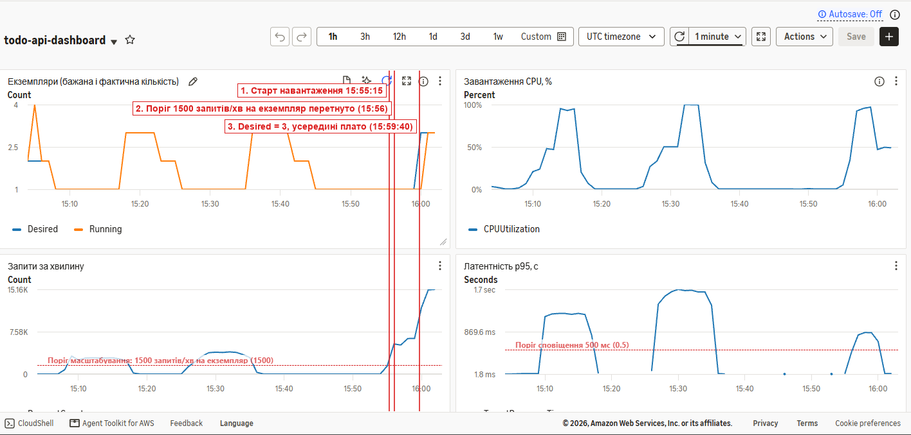
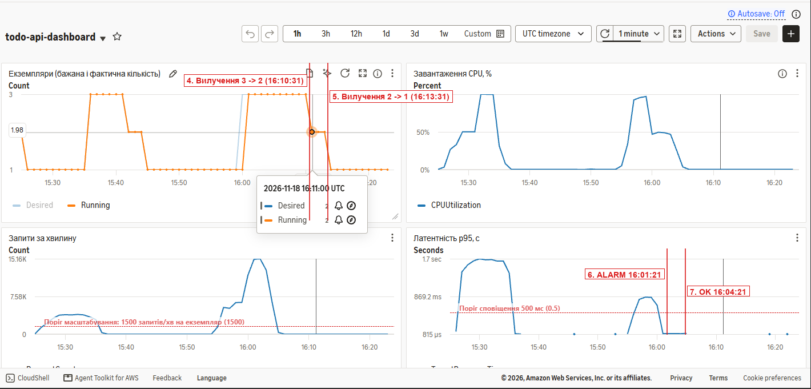
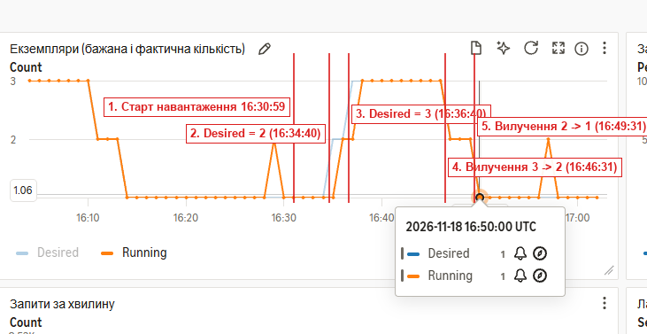
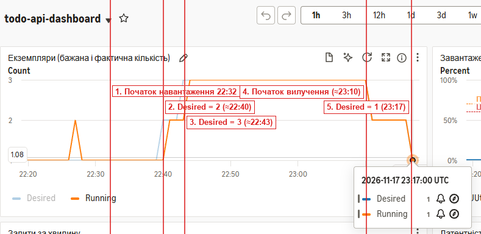

# Автоматичне масштабування

Файл Terraform: [`autoscaling.tf`](../autoscaling.tf). Панель: [`monitoring.tf`](../monitoring.tf).

## Параметри політики

Політика — **step scaling** за кількістю запитів на один екземпляр (метрика ALB `RequestCountPerTarget`, сума за хвилину). Два сигнали CloudWatch запускають дві політики Application Auto Scaling:

| Параметр | Значення | Обґрунтування |
|---|---|---|
| min / max | 1 / 3 | Мінімум — економія; максимум 3 (< 4 за умовою) обмежує витрати і навантаження на RDS `db.t3.micro` |
| Сигнал додавання | ≥ **1 500** запитів/хв на екземпляр, **1** хвилинна точка | Близько чверті того, що один екземпляр обробляв у вимірюваннях (5–6,5 тис. запитів/хв при p95 ≈ 0,8 с, прогін 15:55 за одного екземпляра), тобто сигнал спрацьовує задовго до насичення, і є запас на затримку метрики та запуск контейнера (30–90 с). Одна точка замість трьох — швидка реакція |
| Кроки додавання | 1 500–2 500 → **+1**, від 2 500 → **+2** | Чим сильніше перевищено поріг, тим більше екземплярів додається одразу: при 5 000+ запитів/хв на одному екземплярі відразу до трьох |
| Cooldown додавання | **60 с** | Дати новим екземплярам запуститись і вплинути на метрику, перш ніж додавати ще |
| Сигнал вилучення | < **600** запитів/хв на екземпляр, **3** хвилинні точки поспіль | Низька межа і три точки: не вилучати екземпляр через короткий провал (flapping) |
| Крок вилучення | **−1** екземпляр | Вилучаємо по одному, щоб не залишити сервіс без запасу |
| Cooldown вилучення | **120 с** | Дати метриці стабілізуватися після вилучення |
| Відсутні дані (вилучення) | вважаються порушенням | Коли запитів немає зовсім, ALB не публікує метрику; без цього сигнал вилучення ніколи б не спрацював |

`desired_count` у `aws_ecs_service` додано до `ignore_changes`, щоб `terraform apply` не скидав кількість екземплярів, змінену автомасштабуванням. Те саме для `min_capacity` і `max_capacity` у цільовому ресурсі: їх змінюють заплановані дії (див. [SCHEDULE.md](SCHEDULE.md)). Для метрик `RunningTaskCount`/`DesiredTaskCount` в кластері увімкнено Container Insights.

## Як ми дійшли до цих параметрів

Політику довелося змінювати двічі, бо перші версії додавали екземпляр **після** п'ятихвилинного плато, а не під час нього. Усі часи — UTC.

| Версія | Метрика і поріг | Коли з'являвся екземпляр | Вилучення |
|---|---|---|---|
| 1. Target tracking | CPU, ціль 60 % (3 хвилинні точки поспіль) | 21:47 при плато до 21:45; близько 22:40 при плато до 22:40 | через 24–35 хв після кінця тесту |
| 2. Step scaling | CPU ≥ 60 %, 1 точка | 15:17:16 при плато до 15:16:12; 15:35:16 при плато до 15:34:14 | через 4–8 хв (вже швидко) |
| 3. Step scaling (поточна) | запитів на екземпляр ≥ 1 500, 1 точка | **15:59:40 при плато 15:58:15–16:03:15** (усередині плато) | через 5–8 хв (16:10:31 і 16:13:31) |

**Чому target tracking не підійшов.** Він сам створює сигнали, що вимагають трьох хвилинних точок поспіль вище цілі; метрика CPU для ECS запізнюється ще на 1–2 хв, а Fargate-контейнер стартує 30–90 с. Параметри target tracking змінити не можна (кількість точок задана AWS). Вилучення вимагало 15 послідовних хвилин нижче цілі, тож відбувалось через 24–35 хв після тесту, тоді як методичка очікує «кілька хвилин».

**Чому step scaling за CPU теж не підійшов.** CPU росте ступінчасто: у двох прогонах він тримався на ≈47–50 % протягом 2–3 хвилин, а потім стрибав до 95–100 %. Поріг 60 % перетинався лише через ≈3 хвилини плато, а з урахуванням запізнення метрики дія настала вже після кінця плато. Причину такої ступінчастої поведінки CPU ми не досліджували.

**Чому кількість запитів на екземпляр.** Вона зростає разом із навантаженням з початку наростання: у прогоні 15:55:15 за першу хвилину було 1 417 запитів, а за другу (15:56) вже 5 376. Тому сигнал спрацьовує раніше за CPU. Методичка прямо допускає цю метрику («кількість запитів на екземпляр»). Це також відповідає питанню 2 з переліку: для сервісу, який здебільшого чекає відповіді бази, CPU — поганий показник навантаження, а кількість запитів на екземпляр відображає його точніше.

## Що таке cooldown і що буде при 0

Cooldown (період стабілізації) — час після масштабування, протягом якого політика не виконує нової дії того самого напряму. Нові екземпляри ще стартують, прогріваються й не впливають на метрику; без паузи система реагувала б на застарілі дані.

При cooldown додавання, рівному 0, політика додавала б екземпляри щохвилини, поки метрика ще висока через незавершений запуск попередніх, і дійшла б до максимуму без потреби (перевитрата). При cooldown вилучення, рівному 0, після кожного короткого спаду екземпляр одразу вилучався б, потім знову додавався — «гойдалка» (flapping): постійні холодні старти, обірвані запити, нестабільна латентність.

У нашому step scaling cooldown додавання 60 с, вилучення 120 с.

## Знімки панелі з позначеними моментами

Прогін 18.11.2026, старт k6 **15:55:15 UTC**, VUS = 80, кеш увімкнено. Тест триває 10 хвилин: наростання 3 хв, плато 5 хв (15:58:15–16:03:15), спад 2 хв (кінець 16:05:15).

| № | Подія | Час (UTC) |
|---|---|---|
| 1 | Початок навантаження | 15:55:15 |
| 2 | Перетин порогу: 5 376 запитів/хв на одному екземплярі (поріг 1 500) | 15:56 |
| — | p95 латентності перетнув 500 мс (0,80 с) | 15:57 |
| — | Початок плато | 15:58:15 |
| 3 | `Desired` стало 3 (дія політики), усередині плато | **15:59:40** |
| — | `Running = 3` | ≈16:00–16:01 |
| — | p95 латентності впала до 0,013 с | 16:01 |

| № | Подія | Час (UTC) |
|---|---|---|
| — | Кінець плато / кінець тесту | 16:03:15 / 16:05:15 |
| 4 | Вилучення 3 → 2 | 16:10:31 (через 5 хв 16 с після кінця тесту) |
| 5 | Вилучення 2 → 1 | 16:13:31 (через 8 хв 16 с) |
| 6 | Лист ALARM | 16:01:21 |
| 7 | Лист OK | 16:04:21 |

Моменти масштабування взято з журналу дій Application Auto Scaling (`describe-scaling-activities`), а не лише з графіка.

Другий фінальний прогін (без кешу, старт k6 **16:30:59 UTC**, плато 16:33:59–16:38:59, кінець 16:40:59) підтверджує, що політика працює незалежно від кешу. За журналом дій Application Auto Scaling:

| Подія | Час (UTC) |
|---|---|
| `Desired` стало 2 (крок +1), усередині плато | 16:34:40 |
| `Desired` стало 3 (крок +1), усередині плато | 16:36:40 |
| Вилучення 3 → 2 | 16:46:31 (через 5 хв 31 с після кінця тесту) |
| Вилучення 2 → 1 | 16:49:31 (через 8 хв 31 с) |

Перша дія тут була кроком +1, а не +2, бо перші хвилинні точки вище порога мали 1 881 (16:31) і 2 024 (16:32) запити на екземпляр, тобто потрапили в діапазон «+1» (1 500–2 500). У прогоні з кешем перша така точка (15:56) мала 5 376 запитів і потрапила в діапазон «+2». В обох прогонах від кінця хвилини з перевищенням (16:32:00 і 15:57:00) до дії політики минуло однаково ≈2 хв 40 с.

**Мінімум під час тесту.** Прогін виконувався вдень, коли розклад (завдання 8) тримає мінімум 2. Щоб побачити масштабування з 1 до 3, мінімум тимчасово знижено вручну до 1 (`register-scalable-target`); о 22:00 розклад повертає 1, а о 08:00 знову 2.

## Чому між перетином порогу і появою екземпляра минає час

Від перетину порогу (15:56) до `Running = 3` (≈16:01) минуло приблизно 5 хвилин:

1. ALB публікує хвилинну метрику із запізненням, а сигнал CloudWatch оцінюється раз на хвилину. Виміряно: від кінця хвилини з перевищенням порога (15:57:00) до дії політики (15:59:40) минуло ≈2 хв 40 с; у прогоні без кешу так само (16:32:00 → 16:34:40).
2. Сигнал має спрацювати (одна хвилинна точка в поточній політиці, три в target tracking) і викликати політику.
3. Fargate має запустити задачу: завантажити образ, стартувати контейнер і пройти health-check ALB (30–90 с).

## Чому вилучення відбувається значно пізніше за падіння навантаження

Навантаження зникло о 16:05:15, а перший екземпляр вилучено о 16:10:31, другий о 16:13:31. Сигнал вилучення потребує 3 хвилинних точок поспіль нижче порога (та метрика ще й запізнюється), потім діє cooldown 120 с між вилученнями, а ALB ще тримає екземпляр до завершення поточних запитів (deregistration delay, за замовчуванням 300 с). Асиметрія навмисна: зайвий екземпляр коштує копійки, а нестача — відмови користувачам.

Після кожного тесту слід перевірити, що `Running = 1` (панель або `aws ecs describe-services`).

## Додаток: ранні прогони зі старою політикою (target tracking за CPU)

Збережені як результат перших ітерацій. Прогін 17.11 о 20:41 UTC:

Прогін 17.11 о 22:32 UTC (без кешу, target tracking): `Desired = 2` близько 22:40, `Desired = 3` близько 22:43, вилучення 3 → 2 близько 23:10, 2 → 1 о 23:17.

Піки `Running = 2` о 20:32 і 20:36 17.11 — це не масштабування, а rolling-деплой після `update-service --force-new-deployment`: стара й нова задачі працюють одночасно, `Desired` при цьому лишається 1. У переглянутих прогонах відповідей 5xx не було: на графіку немає даних, бо CloudWatch не пише точок для нульового лічильника.
