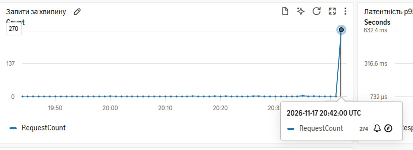
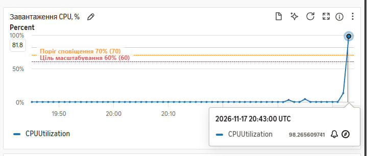
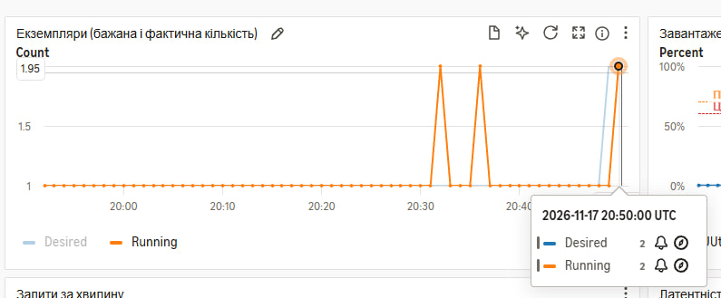
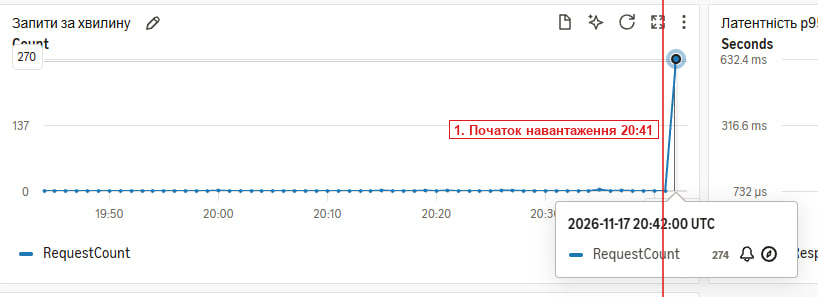
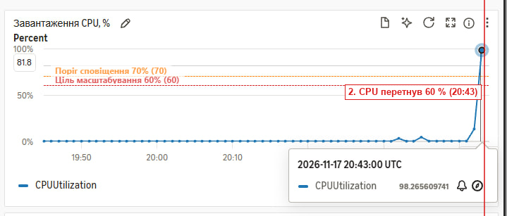
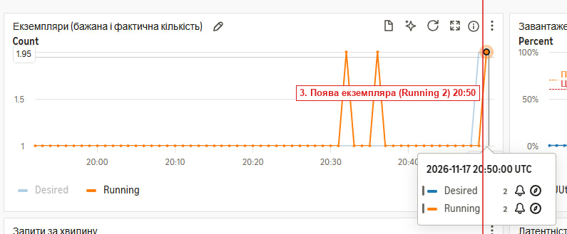

# Автоматичне масштабування

Файл Terraform: [`autoscaling.tf`](../autoscaling.tf). Панель: [`monitoring.tf`](../monitoring.tf).

## Параметри політики

| Параметр | Значення | Обґрунтування |
|---|---|---|
| Тип | `TargetTrackingScaling` | AWS сам обчислює потрібну кількість екземплярів, щоб утримати метрику біля цілі |
| Метрика | `ECSServiceAverageCPUUtilization` | Середнє CPU по всіх задачах сервісу |
| Ціль | 60 % | Запас 40 % поглинає стрибки навантаження за час запуску нового контейнера (30–90 с). Ціль 80–90 % означала б, що екземпляри вже насичені, коли масштабування лише починається; ціль 30 % — зайві витрати |
| min / max | 1 / 3 | Мінімум — економія; максимум 3 (< 4 за умовою) обмежує витрати і навантаження на RDS `db.t3.micro` |
| `scale_out_cooldown` | 60 с | Додаємо швидко |
| `scale_in_cooldown` | 300 с | Вилучаємо повільно, щоб не гойдатися |

`desired_count` у `aws_ecs_service` додано до `ignore_changes`, щоб `terraform apply` не скидав кількість екземплярів, змінену автомасштабуванням. Для метрик `RunningTaskCount`/`DesiredTaskCount` в кластері увімкнено Container Insights.

## Що таке cooldown і що буде при 0

Cooldown (період стабілізації) — час після масштабування, протягом якого політика не виконує нової дії того самого напряму. Нові екземпляри ще стартують, прогріваються й не впливають на метрику; без паузи система реагувала б на застарілі дані.

При `scale_out_cooldown = 0` політика додаватиме екземпляри щохвилини, поки метрика ще висока через незавершений запуск попередніх, і дійде до максимуму без потреби (перевитрата). При `scale_in_cooldown = 0` після кожного короткого спаду екземпляр одразу вилучався б, потім знову додавався — «гойдалка» (flapping): постійні холодні старти, обірвані запити, нестабільна латентність.

## Знімки панелі

Прогін 17.11.2026 (`k6 run`, VUS = 40, кеш увімкнено). Усі часи — UTC (місцевий час = UTC+2).

| Подія | Час (UTC) | Де видно |
|---|---|---|
| Початок навантаження | 20:41:08 (22:41:08 місцевого за `Get-Date`) | [start-time.png](img/start-time.png) |
| Перша хвилина запитів: 274 запити | 20:42 | [requests.png](img/requests.png) |
| Перетин порогу CPU 60 % (за 20:43 — 98,3 %; попередня точка нижче 60 %) | 20:43 | [cpu.png](img/cpu.png) |
| Бажана кількість екземплярів стала 2 | ≈20:48–20:49 (лінія Desired росте до позначки 20:50) | [instances.png](img/instances.png) |
| Другий екземпляр працює (Running = 2) | 20:50 | [instances.png](img/instances.png) |
| Вилучення екземпляра після спаду | Для цього прогону знімка вилучення немає; див. прогони 21:37 і 22:32 нижче | |

Піки Running = 2 о 20:32 і 20:36 на тому самому графіку — це не масштабування, а rolling-деплой: після `update-service --force-new-deployment` стара й нова задачі працюють одночасно, `Desired` при цьому лишається 1.

Відповіді 5xx: на графіку «Відповіді 5xx» немає даних, бо CloudWatch не пише точок для нульового лічильника. Тобто за прогін було 0 відповідей 5xx.

## Чому між перетином порогу і появою екземпляра минає час

1. CloudWatch агрегує метрику CPU по хвилинних періодах і публікує її із запізненням 1–2 хв.
2. Target tracking створює аварійні сигнали, що потребують кількох точок поспіль (3 точки по 1 хв для scale-out), щоб не реагувати на шум.
3. Fargate має запустити задачу: завантажити образ, старт контейнера, пройти health-check ALB (кілька інтервалів).

У цьому прогоні від перетину порогу (20:43) до другого працюючого екземпляра (20:50) минуло близько 7 хвилин.

## Чому вилучення відбувається значно пізніше

Target tracking для scale-in вимагає 15 послідовних хвилин метрики нижче цілі (захист від передчасного вилучення), плюс `scale_in_cooldown = 300 с`, плюс deregistration delay ALB (за замовчуванням 300 с) на завершення поточних запитів. Асиметрія навмисна: зайвий екземпляр коштує копійки, а нестача — відмови користувачам.

Після кожного тесту слід перевірити, що `Running = 1` (панель або `aws ecs describe-services`).

## Часова шкала двох прогонів 17.11 (UTC)

Тривалість кожного прогону — 10 хвилин: наростання 3 хв, плато 5 хв, спад 2 хв.

**Прогін з кешем (старт 21:37:05, плато ≈21:40–21:45, кінець ≈21:47)**

| Подія | Час (UTC) | Знімок |
|---|---|---|
| Початок навантаження | 21:37:05 | — |
| Перший приріст RequestCount (483/хв) | 21:37 | [requests.png](img/requests.png) |
| Перетин порогу CPU 60 % (49 % о 21:38, далі 90+ %) | ≈21:39 | [cpu.png](img/cpu.png) |
| Сигнал тривоги (ALARM) | 21:45:13 | [лист](img/mail-alarm-17.png) |
| Desired = 2 | 21:47 (tooltip) | [instances.png](img/instances.png) |
| Desired = 3 | ≈21:50 | [instances.png](img/instances.png) |
| Вилучення: 3 → 2 | ≈22:11 | [instances.png](img/instances.png) |
| Вилучення: 2 → 1, Desired = 1 | 22:18 (tooltip) | [instances.png](img/instances.png) |

**Прогін без кешу (старт 22:32:07, плато ≈22:35–22:40, кінець ≈22:42)**

| Подія | Час (UTC) | Знімок |
|---|---|---|
| Початок навантаження | 22:32:07 | — |
| Перший приріст RequestCount (790/хв) | 22:33 | [requests-nocache.png](img/requests-nocache.png) |
| CPU 100 % | 22:34 | — |
| Сигнал тривоги (ALARM) | 22:38:13 | [лист](img/mail-alarm-nocache.png) |
| Desired = 2 | ≈22:40 | [instances-nocache.png](img/instances-nocache.png) |
| Desired = 3 | ≈22:43 | [instances-nocache.png](img/instances-nocache.png) |
| Лист про норму (OK) | 22:43:13 | [лист](img/mail-ok-nocache.png) |
| Вилучення: 3 → 2 | ≈23:10 | [instances-nocache.png](img/instances-nocache.png) |
| Вилучення: 2 → 1, Desired = 1 | 23:17 (tooltip) | [instances-nocache.png](img/instances-nocache.png) |

Затримка між кінцем навантаження і вилученням: у прогоні з кешем ≈31 хв (21:47 → 22:18), без кешу ≈35 хв (22:42 → 23:17). Вилучення починається тільки після 15 хвилин метрики нижче цілі, а потім ще діє cooldown та deregistration delay ALB, тому воно відбувається значно пізніше за падіння навантаження.

Точність «≈» — за графіком без tooltip. Точні часи вилучення можна уточнити з панелі при потребі.

Знімки RDS для обох прогонів: [rds-cache-on-2.png](img/rds-cache-on-2.png), [rds-nocache.png](img/rds-nocache.png).

## Знімки панелі з позначеними моментами

Прогін 17.11 о 20:41 UTC (з кешем, перша спроба):

Прогін без кешу, 22:32 UTC — поява і вилучення екземплярів:

Позначки 2 і 3 у першому прогоні стоять за часом з tooltip. Позначки на прогоні без кешу (≈22:40, ≈22:43, ≈23:10) визначені за графіком і можуть відрізнятися на 1–2 хвилини.
