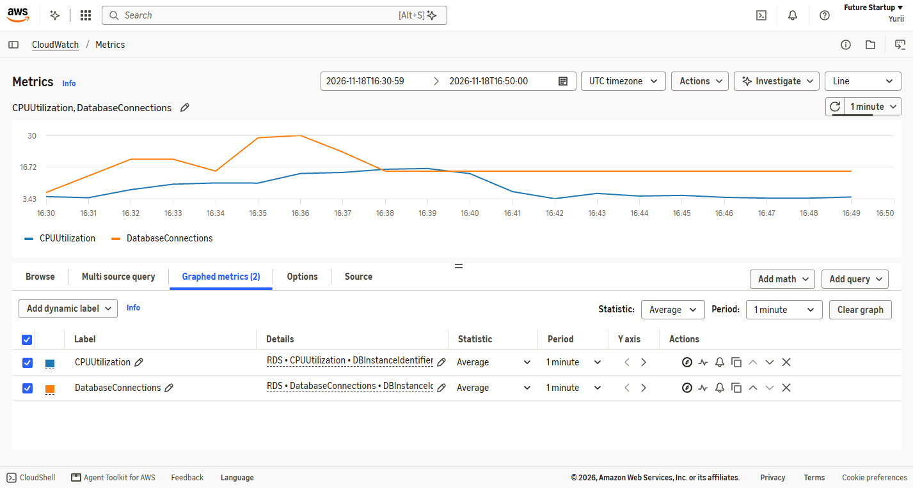

# Кешування

Код: [`app/cache.py`](../app/cache.py), [`app/crud.py`](../app/crud.py). Інфраструктура: [`cache.tf`](../cache.tf) (ElastiCache Redis `cache.t4g.micro`, доступ лише з SG задач ECS). Перемикач: змінна Terraform `cache_enabled` → змінна середовища `CACHE_ENABLED`.

## Схема cache-aside

`GET /tasks/`:
1. Читаємо з Redis ключ `tasks:list:v0:{offset}:{limit}`.
2. Влучання — повертаємо JSON з кешу.
3. Промах — читаємо з PostgreSQL, зберігаємо в Redis з TTL (`CACHE_TTL_SECONDS` = 30 с), повертаємо.

**Актуальність: лише за TTL.** За замовчуванням запис кешу живе 30 с, а записи (`POST/PUT/DELETE`) кеш не скидають. Клієнт може бачити застарілий список до 30 с після запису, зате частка влучань висока навіть при частих записах.

Перша версія скидала кеш при кожному записі: `POST/PUT/DELETE` збільшували лічильник `tasks:version`, і всі ключі списку ставали недосяжними. У сценарії з 1 записом на 9 читань це давало частку влучань лише 21,8 %: кожне читання йшло в базу і ще платило за звернення до Redis, тому кеш *погіршив* латентність. Цей режим залишено як опцію (`CACHE_INVALIDATE_ON_WRITE=true`): дані свіжі, але при частих записах кеш майже не допомагає.

Помилки Redis не ламають сервіс — запит іде в базу, помилка лічиться в `errors_this_instance`. Таймаут Redis — 2 с. Статистика: `GET /cache/stats` → `hits`, `misses`, `hit_ratio`, `ttl`, `invalidate_on_write`.

Кеш — спільний Redis, а не пам'ять процесу: у пам'яті процесу кожен екземпляр мав би власну копію, інвалідація на одному не зачіпала б інших, і клієнти бачили б різні дані залежно від того, куди ALB спрямував запит.

## Порівняння

Однаковий сценарій [`loadtest/script.js`](../loadtest/script.js) (VUS = 80, 10 хвилин), однакове масштабування (step scaling за запитами на екземпляр, мінімум тимчасово 1, максимум 3), обидва прогони 18.11.2026. Єдина різниця — `cache_enabled` (`terraform apply -var cache_enabled=false` і `true`).

| Показник | Без кешу (старт 16:30:59 UTC) | З кешем (старт 15:55:15 UTC) |
|---|---|---|
| Запитів | 48 530 | 86 280 |
| Запитів за секунду | 80,6 | **143,2** |
| Ітерацій сценарію | 4 853 | 8 628 |
| p50 латентності | 200 мс | **42 мс** |
| p95 латентності | 1,50 с | **740 мс** |
| p99 латентності | 1,78 с | **903 мс** |
| Частка помилок | 0,08 % (40 з 48 530) | 0,00 % (0 з 86 280) |
| Пік екземплярів | 3 | 3 |
| Навантаження на базу: RDS `CPUUtilization` (макс. за хвилину) | 16,1 % | 14,6 % |
| Навантаження на базу: RDS `DatabaseConnections` (макс.) | 30 | 17 |
| Частка влучань у кеш (`/cache/stats`) | — | **99,6 %** (25 776 влучань і 108 промахів) |

Знімок RDS (`CPUUtilization` і `DatabaseConnections`) для прогону без кешу, 16:30:59–16:50 UTC: пік CPU бази ≈16 % (о 16:39), пік з'єднань 30 (о 16:36).

Кількість викликів `GET /tasks/` з кешем: 25 776 + 108 = 25 884 = 8 628 ітерацій × 3 читання списку за ітерацію, тобто лічильники збігаються з кількістю запитів сценарію. p95 у k6 — для всіх запитів сценарію (не лише `GET /tasks/`).

**Висновок.** Кеш майже вдвічі збільшив пропускну здатність (80,6 → 143,2 запиту/с), знизив p50 у ≈5 разів (200 → 42 мс), а p95 удвічі (1,50 с → 740 мс). Частка влучань — 99,6 %: за 30 с TTL список перебудовується з бази лише кілька разів на екземпляр, решта запитів обслуговується з Redis.

**Навантаження на базу.** CPU бази в обох прогонах невеликий (≈15 %): `db.t3.micro` не була вузьким місцем. Різниця помітна в кількості з'єднань (макс. 17 з кешем проти 30 без нього), бо з кешем менше запитів доходить до бази. Основний виграш кешу в цьому сценарії — менше роботи застосунку на запит (немає ORM і побудови відповіді з рядків), а не розвантаження бази.

**Як ми дійшли до цього результату.** Перша версія кешу (скидання при кожному записі) давала частку влучань 21,8 % і була гіршою за відсутність кешу: p95 6,99 с проти 5,10 с без кешу, 9,4 проти 13,5 запиту/с. Одночасно сервіс уповільнювала сама `GET /stats`, що завантажувала всю таблицю в Python (див. [LOADTEST.md](LOADTEST.md)). Після виправлення обох причин (кеш за TTL, агрегатний `/stats`) кеш дав виграш, показаний вище.

## Актуальність даних

У режимі за замовчуванням (лише TTL) клієнт може бачити застарілий список **до 30 секунд** після запису: доки не сплине термін запису в кеші. Це свідомий компроміс між свіжістю й швидкістю.

Як скоротити цей час:
- зменшити TTL (наприклад, до 5 с): свіжіші дані, але менше влучань; TTL у 1 с майже зводить кеш нанівець, а в 1 годину означає годину застарілих даних;
- увімкнути інвалідацію при записі (`CACHE_INVALIDATE_ON_WRITE=true`): після запису список оновлюється при наступному читанні (практично 0 с застарілості), але при частих записах кеш майже не працює, як показала перша версія;
- оновлювати або видаляти лише окремі ключі, яких стосується запис (наприклад, кешувати пости за ідентифікатором), а не весь список.

Для користувача, який щойно створив запис, застарілий список може виглядати як «запис зник». Це вирішує read-your-writes: після власного запису читати список в обхід кешу.

Лавинне звернення (cache stampede): при спливі TTL багато запитів одночасно йдуть у базу. Пом'якшення: блокування на перебудову (`SET NX`), випадковий розкид TTL, оновлення в фоні.
